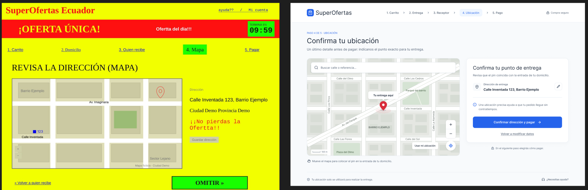

# Informe de Rediseño UX/UI: Pantalla "Revisa la Dirección (Mapa)"
**Proyecto:** SuperOfertas Ecuador | **Asignatura:** Interacción Humano-Computador (IHC)
**Rama:** `feature/rediseno-figma`

## 1. Análisis de Problemas Visuales y Funcionales (Interfaz Original)
El diagnóstico de la pantalla original (`B-4-mapa.png.jpeg`) reveló fallas críticas de usabilidad y la presencia de *Dark Patterns* (Patrones Oscuros):
* **Fatiga Visual y Falsa Urgencia:** Fondo amarillo saturado (`#FFFF00`) y un cronómetro rojo ("TERMINA EN 09:59") que generan ansiedad injustificada.
* **Incongruencia Espacial (MoT 1):** El pin rojo del mapa está en la esquina superior derecha, mientras la dirección textual ("Calle Inventada 123") indica la esquina inferior izquierda.
* **Falta de *Affordance* (MoT 2):** El mapa es una imagen estática; el usuario no puede arrastrar el pin ni hacer zoom.
* **Inversión de Jerarquía (MoT 3):** El botón de acción principal ("Guardar dirección") es gris, pequeño y parece deshabilitado. El botón destructivo/secundario ("OMITIR »") es gigante y verde, empujando al usuario a saltarse la validación.
* **Errores Ortográficos:** Mensajes como "¡¡No pierdas la Ofertta!!" restan profesionalismo y confianza.

## 2. Aplicación de la Matriz UX y Principios IHC
Basado en la evaluación empírica con 3 usuarios (Curva Emocional Inicial de -2.67 en los momentos críticos), se aplicaron las siguientes mejoras:

### Principios de Usabilidad y Accesibilidad
* **Contraste y Legibilidad (WCAG 2.1 AA):** Se eliminó el fondo amarillo. Se adoptó un fondo neutro (`#F8FAFC`) con texto gris oscuro (`#1E293B`) para garantizar la legibilidad.
* **Ley de Fitts y Jerarquía Visual:** El botón de confirmación ahora tiene un tamaño de 48px de alto (área de toque óptima) y utiliza el color primario de la marca.
* **Consistencia:** Se implementó un *Stepper* (Paso 4 de 5) para que el usuario sepa exactamente en qué etapa del *checkout* se encuentra.

### Eliminación de Patrones Oscuros
* Se erradicó el temporizador de falsa urgencia.
* Se eliminó el botón "OMITIR" engañoso. Ahora las acciones son transparentes y éticas.

## 3. Detalles del Rediseño en Figma
El nuevo diseño se estructura en un layout de dos columnas para optimizar el espacio en escritorio (1440x900px):

### A. Mejora en la Visualización del Mapa y Dirección
* **Mapa Interactivo (Columna Izquierda - 60%):** Se diseñó un contenedor de mapa con controles de zoom (+/-) y un botón flotante de "Usar mi ubicación GPS".
* **Pin Centrado:** El marcador rojo ahora está alineado exactamente con la dirección textual, acompañado de un *tooltip* que dice "Tu entrega aquí".
* **Buscador Predictivo:** Se añadió una barra de búsqueda en la parte superior del mapa para corregir la calle manualmente.

### B. Diferenciación Clara de Acciones (Guardar, Volver, Omitir)
Se reestructuró el panel derecho (Columna Derecha - 40%) con una *Card UI* limpia:
1. **Acción Primaria (Guardar/Continuar):** Botón azul corporativo (`#2563EB`) con el texto "Confirmar dirección y pagar". Es el elemento con mayor peso visual.
2. **Acción Secundaria (Volver/Editar):** Enlace de texto discreto "Volver a modificar datos" o un botón *ghost* para editar la dirección escrita.
3. **Acción Terciaria (Omitir):** Se eliminó la acción de "Omitir" forzada. Si el usuario desea omitir la geolocalización exacta, se presenta como un *checkbox* opcional dentro del formulario, no como un botón gigante.

## 4. Comparación Visual: Antes vs. Después
*(Ver imagen adjunta en `evidencias/rediseño/comparativa_antes_despues.png`)*

| Característica | Interfaz Original (Antes) | Interfaz Rediseñada (Después) |
| :--- | :--- | :--- |
| **Estética y Color** | Fondo amarillo chillón, fatiga visual. | Fondo neutro (#F8FAFC), diseño limpio y profesional. |
| **Mapa y Dirección** | Pin desfasado, imagen estática. | Pin centrado en la dirección, controles de zoom y buscador. |
| **Jerarquía de Botones** | "Guardar" gris/pequeño, "OMITIR" gigante. | "Confirmar" azul primario (48px), "Volver" secundario discreto. |
| **Elementos Extra** | Cronómetro de urgencia, errores ortográficos. | Stepper de progreso (Paso 4 de 5), tarjeta de resumen clara. |

## 5. Aplicación de Principios IHC
- **Usabilidad:** Se aplicó la Heurística de Visibilidad del estado del sistema (Stepper) y Libertad y Control (botón Volver claro).
- **Accesibilidad:** Se corrigió el contraste de colores (WCAG AA) y se aumentó el área de toque de los botones a 48px.
- **Consistencia:** Se mantuvo el mismo layout de 2 columnas y tipografía en los pasos 3, 4 y 5 del checkout.

## 6. Prototipo Navegable
El prototipo en Figma incluye las interacciones necesarias para la prueba de usuario:
* **Hover states:** Cambios de color en botones para dar *feedback* visual.
* **Flujo de Confirmación:** Al hacer clic en "Confirmar dirección y pagar", el sistema valida los datos y navega al Paso 5 (Pago).
* **Flujo de Edición:** Al hacer clic en el ícono de lápiz o "Volver", se simula el regreso al Paso 3 (Datos del Receptor).