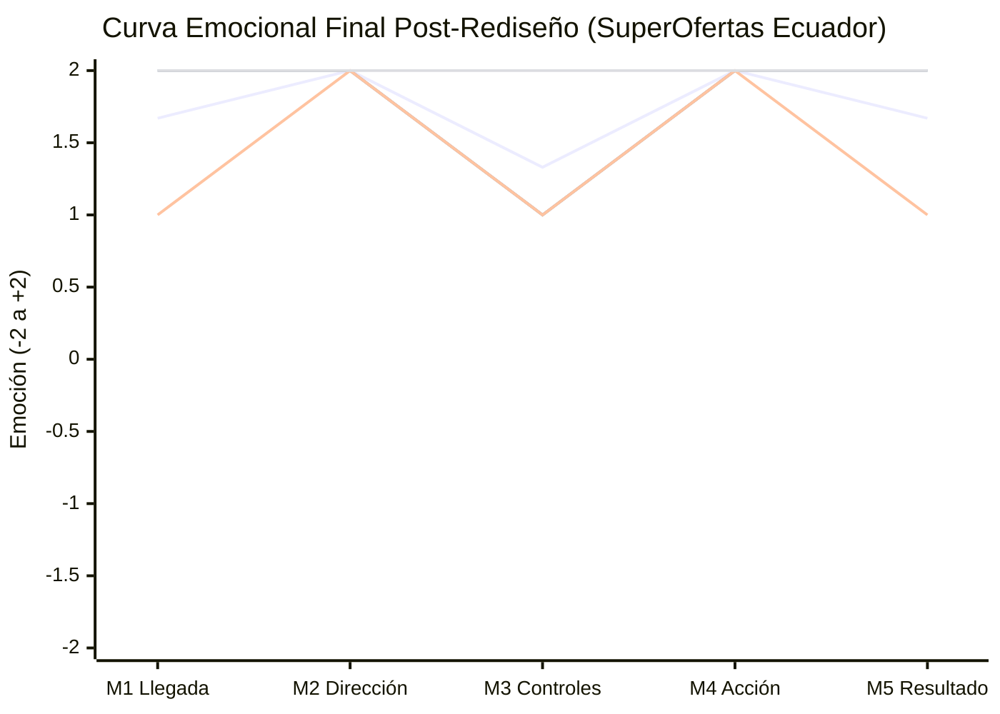
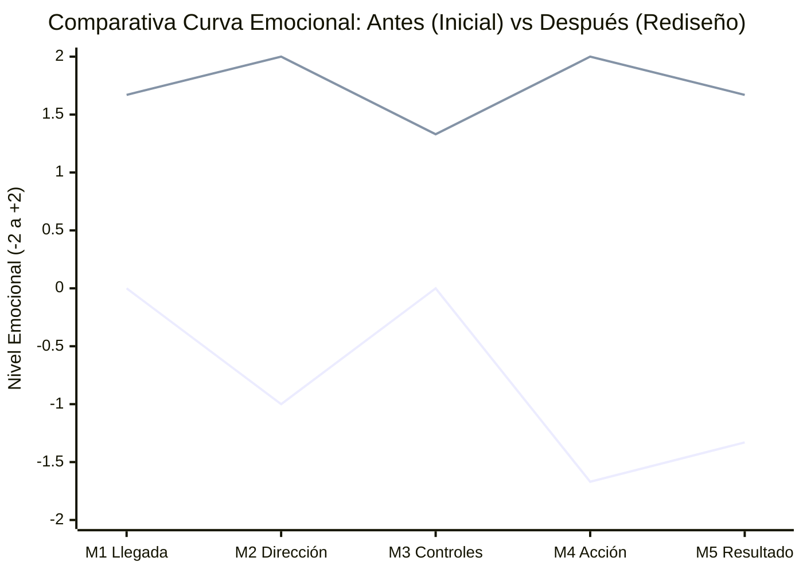

    # 📈 Curva Emocional Final y Análisis Comparativo — SuperOfertas Ecuador

> **Responsable:** Wilson Joseph Pillapa Tubón (`@W1LSONN`)  
> **Proyecto:** SuperOfertas Ecuador — Evaluación y Rediseño UX  
> **Asignatura:** Interacción Humano-Computador (IHC) — FISEI UTA  

---

## 1. Escala Emocional Oficial

| Valor | Nivel | Interpretación de Usabilidad |
|:---:|---|---|
| **+2** | Muy satisfecho | Interacción intuitiva, clara, rápida y con total confianza. |
| **+1** | Satisfecho | Tarea comprendida y completada sin contratiempos. |
| **0** | Neutral | No se experimenta dificultad ni deleite significativo. |
| **-1** | Frustrado | Confusión, retraso o duda durante la tarea. |
| **-2** | Muy frustrado | Bloqueo, ansiedad o riesgo crítico de error. |

---

## 2. Registro de Datos de la Segunda Evaluación (Post-Rediseño)

| Momento de Interacción | Etapa | Daniel | Heidi | Antony | Promedio Final |
|---|---|:---:|:---:|:---:|:---:|
| **M1** Llegada a la pantalla | Antes | +2 | +1 | +2 | **+1.67** |
| **M2** Interpretación de dirección | Durante | +2 | +2 | +2 | **+2.00** |
| **M3** Controles del mapa | Durante | +1 | +1 | +2 | **+1.33** |
| **M4** Selección de la acción | Durante | +2 | +2 | +2 | **+2.00** |
| **M5** Resultado de la decisión | Después | +2 | +1 | +2 | **+1.67** |
| **Promedio por Participante** | | **+1.80** | **+1.40** | **+2.00** | **+1.73** |

*Cálculo de promedios:*
- M1 = (2 + 1 + 2) / 3 = **+1.67**
- M2 = (2 + 2 + 2) / 3 = **+2.00**
- M3 = (1 + 1 + 2) / 3 = **+1.33**
- M4 = (2 + 2 + 2) / 3 = **+2.00**
- M5 = (2 + 1 + 2) / 3 = **+1.67**
- Promedio Global Final = (1.80 + 1.40 + 2.00) / 3 = **+1.73**

---

## 3. Representación Gráfica de la Curva Emocional Final



*Leyenda de líneas:*
1. **Línea 1:** Promedio general del grupo (+1.73 global).
2. **Línea 2:** Daniel Luisa (+1.80).
3. **Línea 3:** Heidi Villavicencio (+1.40).
4. **Línea 4:** Antony Semblantes (+2.00).

---

## 4. Gráfico Comparativo: Curva Inicial vs. Curva Final (Antes vs. Después)



*Series representadas:*
* **Línea 1 (Inferior / Inicial):** Experiencia previa en interfaz original (Promedio -0.80).
* **Línea 2 (Superior / Final):** Experiencia posterior con prototipo rediseñado (Promedio +1.73).

---

## 5. Representación en Texto ASCII (Comparativa Directa)

```text
       M1 Llegada     M2 Dirección   M3 Controles    M4 Acción     M5 Resultado
 +2 |                     ●                             ●
    |      ▲                                            ▲              ▲
 +1 |                     ▲              ▲
    |
  0 |      ●                             ●
    |
 -1 |                     ●                                            ●
    |
 -2 |                                                   ●
----+---------------+---------------+---------------+---------------+---------------
      Antes:  0.00    Antes: -1.00    Antes:  0.00    Antes: -1.67    Antes: -1.33
      Desp.: +1.67    Desp.: +2.00    Desp.: +1.33    Desp.: +2.00    Desp.: +1.67
      (Δ = +1.67)     (Δ = +3.00)     (Δ = +1.33)     (Δ = +3.67)     (Δ = +3.00)
```
*(Simbología: `●` = Interfaz Original | `▲` = Interfaz Rediseñada)*

---

## 6. Análisis del Comportamiento de la Curva

1. **Transformación de trayectoria:**
   - La curva inicial mostraba un comportamiento fuertemente degradante con una caída en picada hacia la zona crítica en M4 (**-1.67**) y M5 (**-1.33**).
   - La curva final se posiciona en su totalidad en la franja de **satisfacción alta** (entre `+1.33` y `+2.00`), eliminando cualquier indicio de frustración o incertidumbre.
2. **Punto de inflexión clave (M4):**
   - El momento de selección de la acción representó la recuperación más notable del proyecto: un salto positivo neto de **+3.67 puntos**, derivado directamente de jerarquizar el botón azul de confirmación de 48px y erradicar la acción manipuladora de omisión.
3. **Consistencia de la confianza (M2 y M5):**
   - Tanto la verificación en el mapa como la retroalimentación del siguiente paso aumentaron en **+3.00 puntos**, validando que la transparencia informativa genera fidelidad y tranquilidad en el usuario de comercio electrónico.
```
