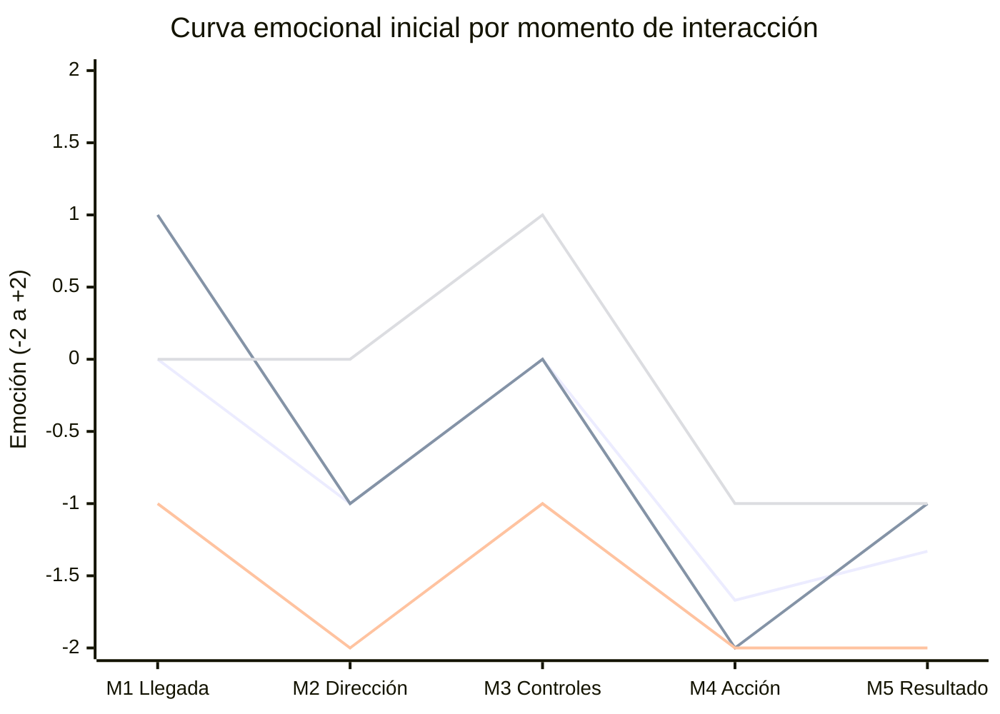

# 📈 Curva Emocional Inicial — SuperOfertas Ecuador

> **Issue #2** · Rama `feature/evaluacion-emocional`
> **Pantalla evaluada:** "Revisa la dirección (Mapa)" — interfaz original
> **Participantes:** Daniel Luisa, Heidi Villavicencio, Antony Semblantes
> **Fuente de datos:** `docs/evaluacion_usuarios.md`

---

## 1. Escala emocional

| Valor | Nivel |
|:---:|---|
| **+2** | Muy satisfecho |
| **+1** | Satisfecho |
| **0** | Neutral |
| **-1** | Frustrado |
| **-2** | Muy frustrado |

## 2. Datos registrados

| Momento | Etapa | Daniel | Heidi | Antony | Promedio |
|---|---|:---:|:---:|:---:|:---:|
| **M1** Llegada a la pantalla | Antes | +1 | -1 | 0 | **0.00** |
| **M2** Interpretación de la dirección | Durante | -1 | -2 | 0 | **-1.00** |
| **M3** Exploración de controles | Durante | 0 | -1 | +1 | **0.00** |
| **M4** Selección de la acción | Durante | -2 | -2 | -1 | **-1.67** |
| **M5** Resultado de la decisión | Después | -1 | -2 | -1 | **-1.33** |
| **Promedio por participante** | | **-0.60** | **-1.60** | **-0.20** | **-0.80** |

Cálculo del promedio por momento: M1 = (1 − 1 + 0) / 3 = 0.00 · M2 = (−1 − 2 + 0) / 3 = −1.00 · M3 = (0 − 1 + 1) / 3 = 0.00 · M4 = (−2 − 2 − 1) / 3 = −1.67 · M5 = (−1 − 2 − 1) / 3 = −1.33.

## 3. Curva emocional

### 3.1 Gráfico (promedio del grupo y curvas individuales)



**Series (en orden de aparición):** 1) Promedio del grupo · 2) Daniel · 3) Heidi · 4) Antony.

> Si el gráfico no se visualiza en tu visor de Markdown, usa la versión en texto de la sección 3.2.

### 3.2 Versión en texto (promedio del grupo)

```
        M1      M2      M3      M4      M5
 +2 |
 +1 |
  0 |   ●               ●
 -1 |           ●                       ●
 -2 |                           ●
    +-------+-------+-------+-------+-------
      0.00   -1.00    0.00   -1.67   -1.33
```

### 3.3 Intensidad por momento

| Momento | Promedio | Representación |
|---|:---:|---|
| M1 Llegada | 0.00 | `░░░░░ ░░░░░` neutral |
| M2 Dirección | -1.00 | `▓▓▓▓▓ ░░░░░` frustración |
| M3 Controles | 0.00 | `░░░░░ ░░░░░` neutral |
| M4 Acción | -1.67 | `▓▓▓▓▓▓▓▓ ░░` frustración alta |
| M5 Resultado | -1.33 | `▓▓▓▓▓▓▓ ░░░` frustración |

## 4. Identificación de momentos

### 🔴 Momentos de frustración

| Momento | Promedio | Por qué ocurre |
|---|:---:|---|
| **M4. Selección de la acción** | **-1.67** | Es el **punto más crítico**. Los tres participantes calificaron con -1 o -2. «OMITIR» es mucho más llamativo que «Guardar dirección», y este último parece deshabilitado. Existe riesgo de que el usuario omita la verificación sin querer. |
| **M5. Resultado de la decisión** | **-1.33** | No hay confirmación ni explicación de lo que ocurre al guardar u omitir. Heidi (-2) no estaría segura de su decisión; Daniel y Antony (-1) solo suponen cuál es el siguiente paso. |
| **M2. Interpretación de la dirección** | **-1.00** | Los usuarios leen la dirección pero no pueden confirmar que el marcador corresponda al lugar. Antony describe el mapa como "ilustrativo". Heidi (-2) pierde confianza en la ubicación. |

### ⚪ Momentos de neutralidad

| Momento | Promedio | Por qué ocurre |
|---|:---:|---|
| **M1. Llegada a la pantalla** | **0.00** | Los usuarios entienden que deben revisar la dirección, pero la opinión se divide: Daniel (+1) la comprende bien, Antony (0) la ve poco ordenada y Heidi (-1) se siente abrumada por colores y promociones. |
| **M3. Exploración de controles** | **0.00** | Los símbolos + y − son reconocidos (Antony +1), pero Daniel (0) y Heidi (-1) no saben si pueden mover el marcador o corregir la ubicación. |

### 🟢 Momentos de satisfacción

No hay ningún momento con satisfacción promedio. Solo se registraron dos valoraciones positivas individuales (+1):

- **Daniel en M1:** entendió rápidamente que debía revisar su dirección, a pesar de la distracción visual.
- **Antony en M3:** los símbolos más y menos le resultaron conocidos.

Los aspectos mejor valorados en las preguntas de cierre fueron la **dirección escrita**, el **título de la pantalla** y la **secuencia de pasos de compra**.

## 5. Análisis de la curva

La curva muestra un recorrido **descendente con una recuperación parcial**:

1. **M1 → M2:** la emoción cae de 0.00 a -1.00. Una vez que el usuario entiende la tarea, se enfrenta a la dificultad de verificar la dirección en el mapa.
2. **M2 → M3:** se recupera a 0.00. Los controles del mapa resultan conocidos y no generan frustración propia, aunque no resuelven la duda del momento anterior.
3. **M3 → M4:** cae a su punto mínimo (-1.67). Al llegar a la decisión, la jerarquía invertida de los botones genera la mayor frustración.
4. **M4 → M5:** se mantiene baja (-1.33). La falta de confirmación no permite cerrar la experiencia con confianza.

**La experiencia termina en frustración**, sin un momento de alivio o confirmación al final de la tarea.

### Diferencias entre participantes

| Participante | Promedio | Perfil de la curva |
|---|:---:|---|
| Heidi | -1.60 | Negativa en casi todo el recorrido; el punto más bajo se mantiene de M4 a M5 en -2. |
| Daniel | -0.60 | Parte en positivo (+1) y cae fuertemente en M4 (-2). |
| Antony | -0.20 | La más estable; solo baja en M4 y M5 (-1). |

Los tres coinciden en que **M4 y M5 son los momentos más débiles**, aunque la intensidad varía según su tolerancia a la saturación visual y su necesidad de seguridad al decidir.

## 6. Momentos críticos y explicación

| Prioridad | Momento | Promedio | Problema | Principio de IHC involucrado |
|:---:|---|:---:|---|---|
| 1 | M4. Selección de la acción | -1.67 | «OMITIR» domina visualmente y «Guardar dirección» parece inactivo. | Jerarquía visual, prevención de errores, consistencia |
| 2 | M5. Resultado de la decisión | -1.33 | Sin confirmación ni indicación del siguiente paso. | Visibilidad del estado del sistema |
| 3 | M2. Interpretación de la dirección | -1.00 | Marcador y dirección escrita no se relacionan con claridad. | Correspondencia entre el sistema y el mundo real |

## 7. Contraste con las hipótesis iniciales

| Momento | Hipótesis | Resultado | Valoración |
|---|---|---|---|
| M1 | Confusión | Neutral | Más favorable que lo esperado |
| M2 | Incertidumbre | Frustración | Confirmada, con más intensidad |
| M3 | Frustración leve | Neutral | Más favorable que lo esperado |
| M4 | Confusión / frustración | Frustración alta | Confirmada; punto más crítico |
| M5 | Incertidumbre | Frustración | Confirmada, con más intensidad |

Los dos momentos críticos planteados inicialmente (M2 y M4) se confirmaron, y se suma **M5** como tercer punto crítico.

## 8. Conclusiones

1. El promedio global de la experiencia es **-0.80**, lo que indica una experiencia **negativa** en la interfaz original.
2. La frustración se concentra en las **decisiones y la confirmación** (M4 y M5), no en la comprensión inicial de la pantalla.
3. Las prioridades de rediseño son: (1) **jerarquizar los botones** para que «Guardar dirección» sea la acción principal, (2) **añadir confirmación y explicar qué ocurre al omitir**, y (3) **hacer más clara la relación entre el marcador y la dirección**, permitiendo editar la ubicación.
4. La reducción de la saturación visual es un aporte secundario, pero relevante para participantes más sensibles a la distracción (Heidi).
5. Estos resultados serán la **línea base** para comparar con la curva emocional final, tras el rediseño en Figma y la segunda prueba (Issue #4).

## 9. Limitaciones

- Evaluación realizada sobre una captura estática, sin interacción real con el mapa.
- Muestra de tres participantes.
- Valores autorreportados, sin medición fisiológica ni observación directa.

## 10. Datos entregados a la matriz UX

Los promedios por momento (0.00, -1.00, 0.00, -1.67, -1.33) y los problemas confirmados se comparten con **Viviana Sarco** para completar `docs/matriz_ux.md`.
